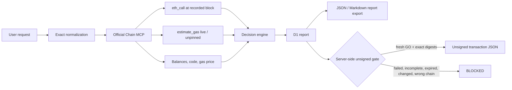

# Architecture

## Trust and provenance

The browser submits only a request. The Worker performs Chain MCP reads and computes the authoritative report. D1 stores the exact report used by the export gate. The browser cannot convert a downloaded/static report into an authorized export.

`eth_call` is block-pinned because the live official schema advertises `block`. `estimate_gas` and `get_gas_price` expose no block parameter and are labeled live/unpinned. Since the advertised tool list contains no trace/state-diff method, effect previews are models or unknowns rather than claimed observed post-state.

The preparation endpoint recomputes the normalized request and both digests, validates internal report integrity, checks chain `1672`, checks complete successful call/estimate evidence, and enforces the five-minute expiry. It emits data only; no signing or broadcasting code exists.
